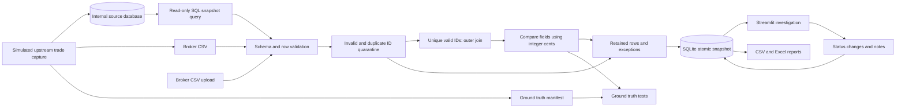
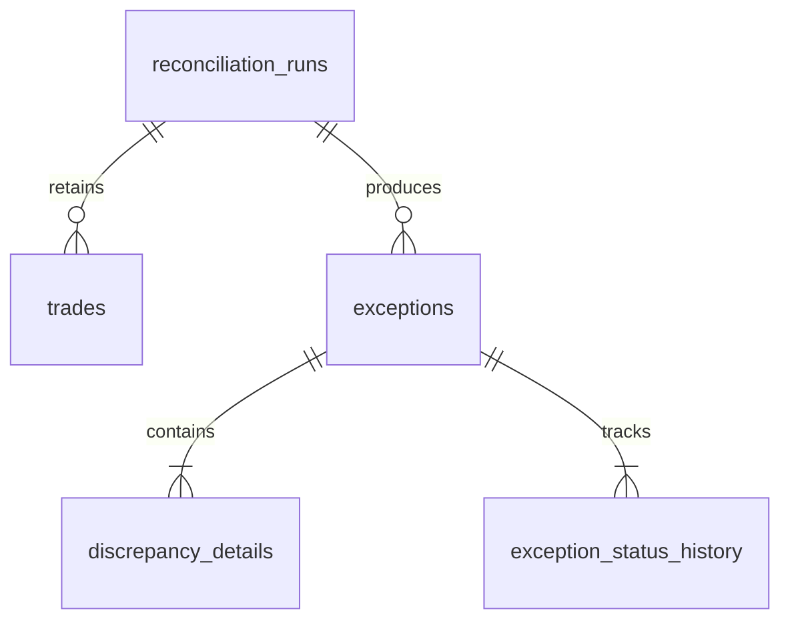

# TradeOps architecture

The pure engine does not depend on Streamlit or SQLite. The repository stores completed snapshots and workflow changes; reports read those snapshots plus current statuses.



## Database relationships



- Runs have unique content/policy fingerprints, UTC timestamps, engine version, tolerance, and immutable summary JSON.
- New runs also store internal source snapshot metadata and broker-file hashes. An additive column upgrade preserves existing runs and statuses from the earlier two-CSV implementation.
- Trades use surrogate primary keys, run foreign keys, source, CSV record number, trade ID, original/normalized JSON values, and validation errors. `(run_id, source, row_number)` is unique; trade IDs deliberately are not.
- Exceptions have run foreign keys, constrained severity/status, and JSON source snapshots and differences. Individual discrepancy rows make counts explicit. JSON keeps this prototype small; frequently queried metadata use SQL columns and indexes.
- History stores old/new state, note, and UTC timestamp, including initial creation. Resolution notes are enforced in application logic and a database check.
- Bound parameters separate SQL from values. Connections enable foreign keys. Imports and workflow transitions are transactions; `BEGIN IMMEDIATE` serializes fingerprint checks and state updates. A failed write rolls back the entire import.

## Interfaces and reproducibility

`generate(seed)` returns three DataFrames. `InternalTradeStore.seed_snapshot(...)` simulates upstream capture into a separate SQLite database. `load_snapshot(id)` reads complete rows plus metadata in one read-only transaction and verifies stored content hash/row count. `Repository.import_internal_snapshot(store, id, broker_bytes, tolerance_cents)` passes the database DataFrame and parsed broker file directly to `reconcile(...)`, then returns `(run_id, created)`. It does not serialize internal trades through CSV. `Repository.import_csv(...)` remains solely for backward compatibility and existing fixture tests. Report builders read one run and its current statuses. Streamlit session state stores selection, not authoritative workflow data.

The source database has `internal_snapshots` and `internal_trade_records` tables with primary keys, foreign keys, and indexes on snapshot/trade ID and snapshot/trade date. Surrogate row keys preserve injected duplicates. Snapshot selection defines the whole reconciliation population. Never filter internal extraction to the broker's list of IDs: doing so would hide missing confirmations. Only seeding writes the source; exception resolution writes the separate results database.

Example source query (the actual implementation selects every required field):

```sql
SELECT trade_id, symbol, side, quantity, price, trade_date,
       settlement_date, currency, broker
FROM internal_trade_records
WHERE snapshot_id = ?
ORDER BY source_row;
```

The placeholder is bound to a chosen snapshot ID. Fixed source snapshots make historical runs reproducible; a future integration would need an agreed scope/cutoff and approved read access to an upstream system. This prototype models a source extract/landing table rather than a complete OMS or ledger.

Generation uses a local seeded random generator and fixed January 2026 dates. Only capture/run timestamps use the clock. Repeat-import identity includes internal snapshot content, broker-file bytes, source type, policy, and engine version; increment the engine version when changing result semantics. Different source data create a new independent run; exceptions are not linked across runs.

Structural CSV errors abort with feedback. Row errors remain in the saved result. Invalid/duplicate usable IDs block both sides from matching. Blank IDs become separate exceptions using source/record position internally. Remaining records use a validated one-to-one outer join. Resolving never rewrites the original result.

Generated files and SQLite live in gitignored `data/`. No service, worker, scheduler, migration framework, external API, or cloud component is required.

## Single-trade walkthrough

The sidebar also selects a manual interview workspace. `run_single_trade(...)` accepts one internal record and one broker record (either may be absent, but not both). It seeds the internal record into `data/manual_demo/internal.sqlite3`, converts the broker confirmation to an in-memory CSV, and calls the same `import_internal_snapshot(...)` method. Results are stored in `data/manual_demo/results.sqlite3`. There is no second matching algorithm or bypass of database extraction/validation.

The walkthrough displays the submitted source values, differences, severity, and workflow history, and exports the normal reports. Identical scenarios reopen their existing run; edits create independent runs. Its saved scenarios and source snapshots are separate from portfolio data, and form edits apply only on submission.
